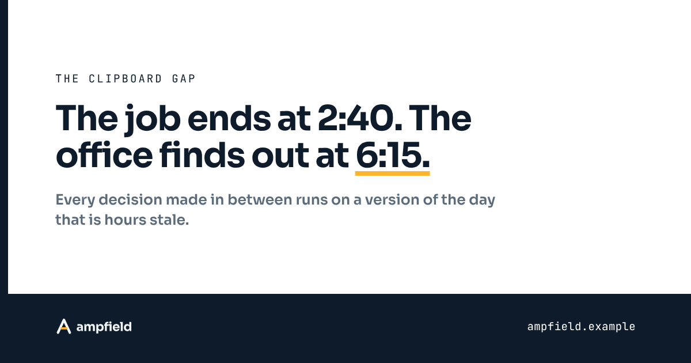
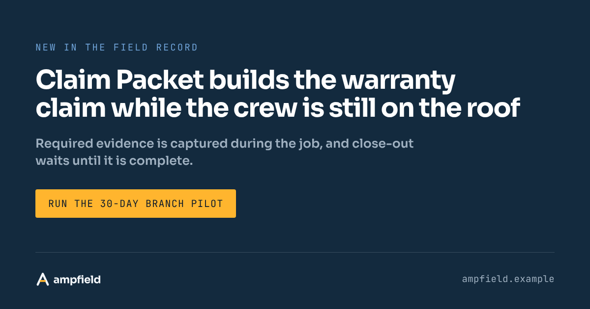
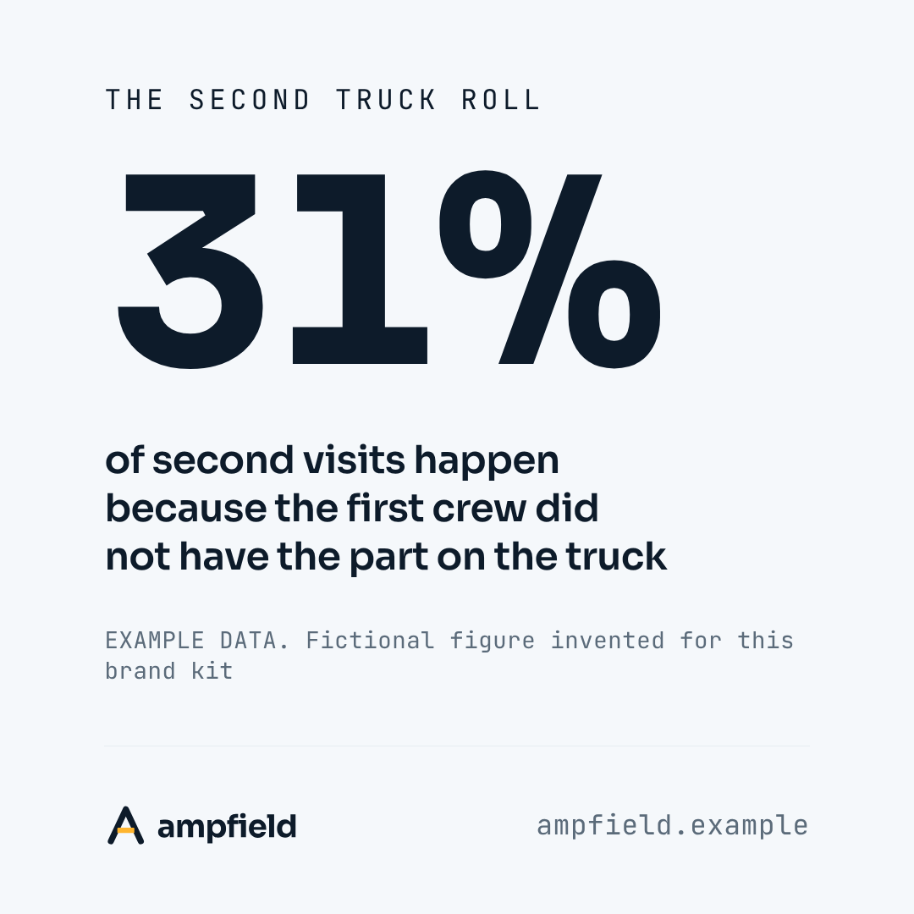
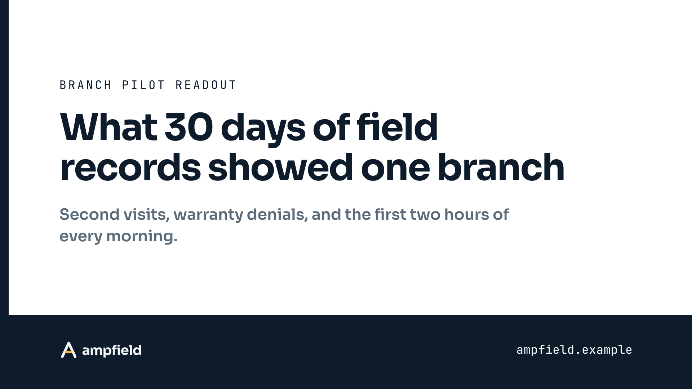

# What `brand-visuals` makes from the Ampfield kit

Everything here was rendered from `examples/ampfield/brand.md` by the two
commands below, run from the repository root. Every number is fictional and
labeled as example data, like every number in the Ampfield kit.

```
node skills/brand-visuals/scripts/render-card.mjs examples/ampfield/renders/cards.json --kit examples/ampfield --out examples/ampfield/renders
node skills/brand-visuals/scripts/render-pdf.mjs examples/ampfield/renders/sample-report.html --kit examples/ampfield --out examples/ampfield/renders/sample-report.pdf --dated
```

`cards.json` is the spec for every card. `manifest.json` is what the render
wrote back: the alt text and the result of every check, per file.

## Cards

**`og-article.png`**, the article variant at link-preview size. The accent is
too light to read as text on white, so the marked phrase is underlined in it.



**`og-announcement.png`**, the announcement variant. The CTA button is the one
accent, with its words taken from `Calls to Action`.



**`square-stat.png`** and **`portrait-quote.png`**, feed sizes. The stat card
will not render without a source line. The quote is from a cleared row in
`Internal Quotes`.




**`banner.png`**, a LinkedIn profile banner, with the text kept to the right of
the profile photo. **`slide-title.png`**, a 16:9 title slide. **`avatar.png`**,
the mark alone.





## Carousel

`carousel-traps.pdf` is a five-page LinkedIn document post, built from four
different variants. The page PNGs are kept beside it.

Ampfield ships no developer tooling, so its kit marks `Terminal` as not used
and there is no `tool` card here. `.github/social-preview.png` at the root of
the repository is one.

## Document

`sample-report.pdf` is a two-page readout rendered from `sample-report.html`,
which was built from `skills/brand-visuals/assets/document.html`. It shows stat
tiles, a status callout, a table with verdict pills that repeats its header
across the page break, a worked calculation, a bar chart, a pull quote, and the
closing CTA.
